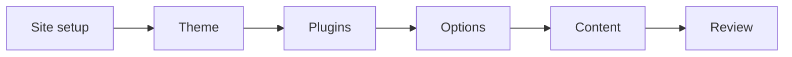

# RH Blueprint Builder

The new plugin is a guided export of the current WordPress site into a [Blueprint v2](https://playground.wordpress.net/blueprint-schema.json) file. The file sets `"version": 2`. Playground compiles those declarations into steps. The old plugin in `../blueprint-builder` is the behavior reference only: it has no choices, it emits deprecated v1 fields, and serialized options do not survive Playground.

This document is the spec. It does not include plugin code.

## What the old plugin gets wrong

`../blueprint-builder/src/class-builder.php` loads raw `wp_options` values and puts them in `setSiteOptions`. Serialized values are still PHP strings such as `a:1:{...}`. Playground applies each value with `update_option()`, and WordPress re-serializes any string that already looks serialized, so `get_option()` returns a string instead of the array.

It also emits v1 fields the current schema rejects or marks deprecated. The new file does not emit them:

- `phpExtensionBundles` is deprecated and unused.
- Top-level `description` is deprecated. Gallery text belongs in `blueprintMeta`.
- The `importFile` step is gone. Content import is `importWxr`.
- `pluginZipFile` and `themeZipFile` are deprecated. V2 uses `plugins`, `themes`, and `activeTheme`.
- The v1 `login` step’s `password` field is deprecated. V2 uses `applicationOptions.wordpress-playground.login`.
- PHP 7.2 and 7.3 must not be written. Use 7.4 or newer.
- Top-level `landingPage`, `features`, and `preferredVersions` are v1. V2 uses `applicationOptions`, `phpVersion`, and `wordpressVersion`.
- `../blueprint-builder/src/class-admin.php` builds the blueprint on every page load, including one WordPress.org request per plugin.
- `../blueprint-builder/src/class-endpoint.php` exposes the JSON and a full WXR export with `permission_callback` set to `__return_true`.

## Product decisions

- Wizard job: detect this site, then let the user include or exclude items before download.
- Version 1 of the plugin covers a site snapshot only: gallery metadata, PHP and WordPress versions, networking, login, WordPress.org plugins, the active theme, site options, content import, and a landing page. The file it writes is Blueprint v2.
- No public REST routes and no Playground link that points at this site. Playground cannot fetch localhost, and a public export URL exposes the site.
- Content: the admin downloads a WXR file, hosts it somewhere public (GitHub or any other HTTPS URL), pastes that URL back, and the blueprint’s `importWxr` step uses it. The download explains that the file is meant to be published, and it leaves out author email addresses.
- Audience: anyone who can `manage_options` on a single site. The screens explain Playground, what will be published, and what the plugin refuses to copy. Nothing in the wizard assumes a particular author, theme, or plugin.
- Options: show a curated list, and let the user add any option that is not on the secret denylist. Plain strings go in top-level `siteOptions`. Arrays and objects go in a final `setSiteOptions` step as JSON, so a plugin activation routine cannot overwrite them.

## Wizard

One Tools menu page, `manage_options`, slug `rh-blueprint-builder`, so it can sit beside the old plugin. PHP renders every field. A small script shows one step at a time, runs option search, and keeps the review JSON in view. No React and no build step. A React admin app would need a toolchain for a checklist that PHP already handles.

Draft answers are stored in user meta so the user can download the WXR, leave to upload it, and return to paste the URL. Leaving the page does not discard the draft.



1. **Site setup.** Short explanation: this builds a WordPress Playground demo of the current site and does not change the site. Gallery metadata is off by default. When the user turns it on, `blueprintMeta.name` prefills from the site title, `blueprintMeta.authors` is a one-item array containing their GitHub username, and `blueprintMeta.description` is optional. Omit `blueprintMeta` when name or author is missing. PHP version prefilled from this site. WordPress version defaults to `latest`, with the current site version offered as the other choice. Checkbox for `networkAccess`, on by default, because v2 defaults it to `false` and plugin installs plus the remote WXR need it. Landing page defaults to `/` when this site has a static front page, and to `/wp-admin/` otherwise. Login defaults to `true`, which logs in as `admin`. A custom username is written as `{ "username", "password" }` because the schema requires both. That password defaults to Playground’s `password` and is labeled as the Playground password, not a password from this site. Site language is `siteLanguage` when the locale is not `en_US`.
2. **Theme.** `activeTheme` is the WordPress.org slug of the active theme. A parent that is also on WordPress.org goes in `themes` and is not activated. If the theme or its parent is not on WordPress.org, show a warning and omit that install. Do not copy the old Twenty Twenty-Four skip.
3. **Plugins.** `plugins` is the list of selected WordPress.org slugs. Activation defaults to true. Active plugins are checked by default. Inactive WordPress.org plugins are unchecked. This plugin is hidden. Plugins that are not on WordPress.org are listed as skipped, with no install entry and no special cases for particular plugins. Cache the WordPress.org lookup in a transient. Do not call the API on every refresh.
4. **Options.** Curated groups, each row removable: useful core settings (title, tagline, timezone, date and time formats, permalinks, discussion, media sizes), `theme_mods_{stylesheet}`, and widget options. Also show options whose names match a selected plugin slug. An “Add option” search can pull in any other option except the denylist. Serialized values are shown as truncated JSON so the user can recognize them. Options whose names contain `license`, `api_key`, `apikey`, `secret`, or `token` are unchecked and labeled as likely secrets. Do not put `page_on_front`, `page_for_posts`, or `show_on_front` in this list. Those are written later by slug, because a copied post ID will not match the page Playground imports. Do not copy site language here; site setup writes `siteLanguage`.
5. **Content.** Off by default. When on: download WXR for published posts and pages (`export_wp`, admin-only, as a file download), with a checkbox to include drafts and private content. The page says the file is meant to be hosted in public, that it can contain the full text of the exported content, and that author email addresses are removed before download. Instructions cover publishing it at a public HTTPS URL, then a required URL field. Checkbox for `rewriteUrls`, on. Checkbox for `fetchAttachments`, on, matching the schema default. Attachments only work when Playground can download the original media files. The page says very large sites can hit the server’s PHP time limit during export. Author usernames on this site are mapped to the Playground login username, and the screen says imported posts will belong to that user. Turning content on also sets `contentBaseline` to `"empty"`.
6. **Review.** Pretty-printed Blueprint v2 JSON, validation messages, and a download button. Above the download, state that the JSON can contain site text and plugin settings, including license or API values the user checked, and that it should be read before it is committed to a public repository. Block download if gallery metadata is on and name or author is missing, or if content is on and the WXR URL is missing or not HTTPS. When content is on and this site has a static front page, the preview includes the front-page step. When content is off, the preview says the front page cannot be resolved without the WXR import.

## Blueprint shape

Target Blueprint v2. Omit empty optional objects.

- `$schema`: `https://playground.wordpress.net/blueprint-schema.json`
- `version`: `2`
- `blueprintMeta` only when the user opts into gallery metadata and both name and author are filled
- `phpVersion` and `wordpressVersion`
- `applicationOptions.wordpress-playground` with `landingPage`, `login`, and `networkAccess`
- `siteLanguage` when the locale is not `en_US`
- `activeTheme`, and `themes` when a WordPress.org parent must be installed first
- `plugins`
- `contentBaseline`: `"empty"` when content import is on. Omit it otherwise so the default `keep-all` remains. `"empty"` clears the fresh Playground posts, pages, and comments before import, with no 100-item cap.
- `siteOptions` for plain strings such as `blogname` and `permalink_structure`. A changed permalink structure also flushes rewrite rules.
- `additionalStepsAfterExecution`, in this order:
  1. `importWxr` when content is on
  2. The front-page `runPHP` step when content is on and this site has a static front page
  3. One `setSiteOptions` step for selected arrays and objects

`importWxr` uses `file.resource` of `url`, plus `rewriteUrls`, `fetchAttachments`, `authorsMap`, and `defaultAuthorUsername` set to the Playground login username.

`additionalStepsAfterExecution` runs after plugins, themes, `contentBaseline`, and top-level `siteOptions`. That is why the import, the front-page lookup, and complex options live there.

Do not emit `phpExtensionBundles`, top-level `description`, `landingPage`, `features`, `preferredVersions`, `resetData`, `importFile`, `pluginZipFile`, `themeZipFile`, a v1 `login` step, or a `steps` array.

PHP versions written to the file must be one of `7.4`, `8.0` through `8.5`, or `latest`. Map 7.2 and 7.3 to 7.4. WordPress version defaults to `latest`. The site’s `major.minor` is available in the wizard. Use `nightly` when this site is not on a numeric release and the user picks the site version.

When the plugin is built, open one generated v2 file in the Playground UI before calling the exporter done. The handbook still documents v1. The Playground repository compiles and runs v2.

## Front page

When this site shows a static front page (`show_on_front` is `page` and `page_on_front` points at a page), do not copy the numeric ID. After `importWxr`, emit a `runPHP` step that loads the imported page by path and then sets the options.

Resolve the path on this site with `get_page_uri()` so a child page keeps its parent path, not only the leaf slug. Escape that path for a single-quoted PHP string. The generated step matches this shape, with the site’s real path in place of `front-page`:

```json
{
  "step": "runPHP",
  "code": "<?php require '/wordpress/wp-load.php'; $page = get_page_by_path( 'front-page', OBJECT, 'page' ); if ( $page instanceof WP_Post ) { update_option( 'page_on_front', (int) $page->ID ); update_option( 'show_on_front', 'page' ); }"
}
```

The `instanceof` check is the only addition to that pattern. Without it, a missing page is a fatal error on PHP 8.

If a posts page is set, append the same lookup for `page_for_posts` in that same `runPHP` step, using that page’s path. Skip the whole step when content import is off, and say so in the review screen: the front page cannot be resolved unless the WXR import runs first. Refuse `page_on_front`, `page_for_posts`, and `show_on_front` in “Add option” for the same reason. There is no free-form PHP step.

## Site options

Plain strings, such as `blogname` and `permalink_structure`, go in top-level `siteOptions`. V2 passes arrays and objects through `update_option()` as PHP arrays.

Arrays and objects do not go there. Top-level `siteOptions` is applied before plugins activate, and an activation routine can overwrite plugin settings with defaults. Read those values with `get_option()` so they are already unserialized, then write them as JSON in one `setSiteOptions` step at the end of `additionalStepsAfterExecution`:

```json
{
  "step": "setSiteOptions",
  "options": {
    "alerts_dlx": {
      "headline_style": "h2",
      "headline_force_size": true,
      "debug_mode": false
    }
  }
}
```

Split into another step only when the JSON would be enormous, and never split one option across steps. Do not emit a PHP serialized string and do not use `maybe_unserialize()`.

Never offer, and refuse to add:

- salts and secret keys (`auth_key`, `auth_salt`, `logged_in_key`, `logged_in_salt`, `nonce_key`, `nonce_salt`, `secure_auth_key`, `secure_auth_salt`)
- mail server host, login, password, and port
- `cron`, `rewrite_rules`, `active_plugins`, `recently_activated`, `uninstall_plugins`
- `siteurl`, `home`, `template`, `stylesheet` (Playground and the theme declaration set these)
- `page_on_front`, `page_for_posts`, and `show_on_front` (the front-page `runPHP` step sets these by slug after import)
- transients, site transients, recovery keys, updater locks, `db_version`, `initial_db_version`
- this plugin’s own options

## Public release

The plugin is for other site administrators, not one person’s demo workflow. The future plugin includes:

- `README.md` for the GitHub repository: what a Blueprint v2 file is, the six wizard steps, the requirement to host the WXR yourself, and the statement that the plugin does not change the live site and does not open a public URL on it. Distribution is GitHub only. There is no WordPress.org readme, directory artwork, or SVN release. Plugin name RH Blueprint Builder, text domain `rh-blueprint-builder`, GPL-3.0-or-later. Plugin URI is the GitHub repository once it exists.
- Every user-facing string wrapped for translation and loaded with the text domain.
- Names prefixed with `rh_blueprint_builder_` for user meta, nonces, and AJAX actions, so the plugin can be active beside the old Blueprint Builder.
- Admin form nonces, `manage_options` on every action, escaped output, and `$wpdb->prepare()` for option lookups.
- `uninstall.php` deletes the draft user meta for every user. Transients are left to expire.
- Single site only. On multisite, or in network admin, the menu shows a short notice and does not run the wizard.
- The WXR response is buffered from `export_wp()` and `wp:author_email` values are emptied before the file is sent. Playground does not need those addresses because authors are mapped to the login user.

The GitHub README and the safety rules above are the public release. A WordPress.org directory submission is out of scope.

## Suggested layout when the plugin is built

All of this lives in this plugin directory, which already has the GPL-3.0 license. Do not modify `../blueprint-builder`.

- `rh-blueprint-builder.php` — header, constants, bootstrap. Name: RH Blueprint Builder. Text domain: `rh-blueprint-builder`. Requires PHP 7.4 and WordPress 6.4.
- `README.md` — GitHub description of the wizard and its limits
- `uninstall.php` — removes draft user meta
- `src/class-plugin.php` — hooks
- `src/class-admin.php` — wizard screens and draft user meta
- `src/class-detector.php` — versions, theme, plugins, curated options, option search
- `src/class-blueprint.php` — schema-safe Blueprint v2 JSON
- `src/class-wxr.php` — admin-only WXR download
- `assets/wizard.js` and `assets/wizard.css` — show one step at a time, option search, and the review preview

Option search is an admin AJAX or REST route with a nonce and a `manage_options` check.

## Out of scope for version 1

A v1 blueprint, a general `runPHP` editor, `wp-cli`, SQL, filesystem steps, wp-config constants, multisite, mu-plugins, installing plugins or themes that are not on WordPress.org, and editing the JSON inside the wizard beyond the fields above. The only generated `runPHP` step is the front-page lookup. A user-written PHP step is not.
